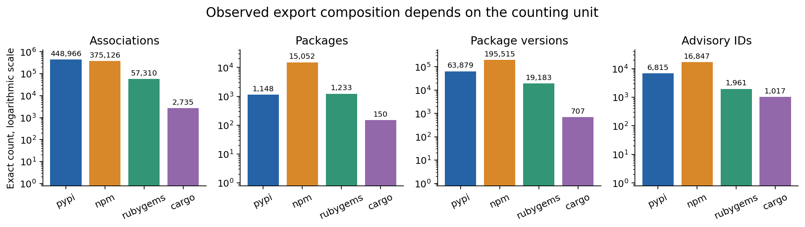
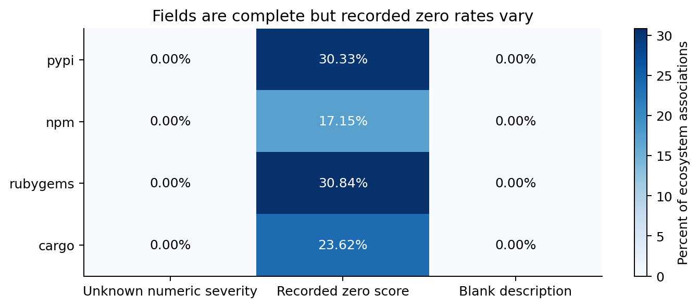
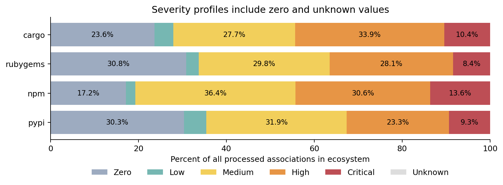
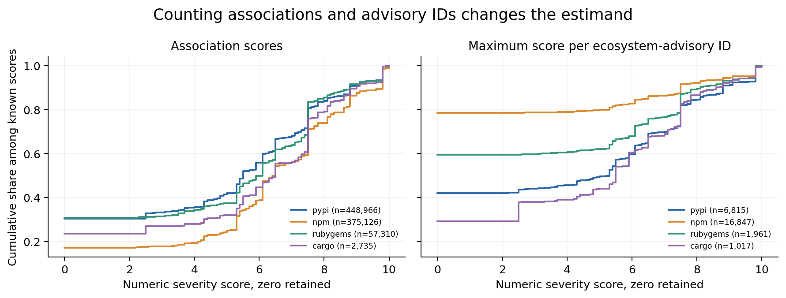
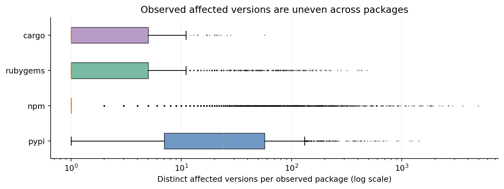
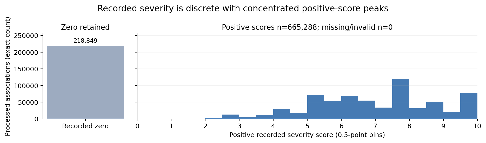
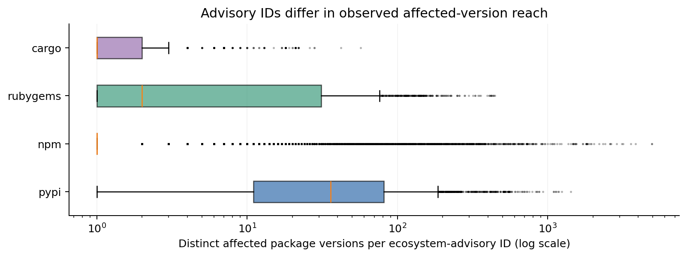
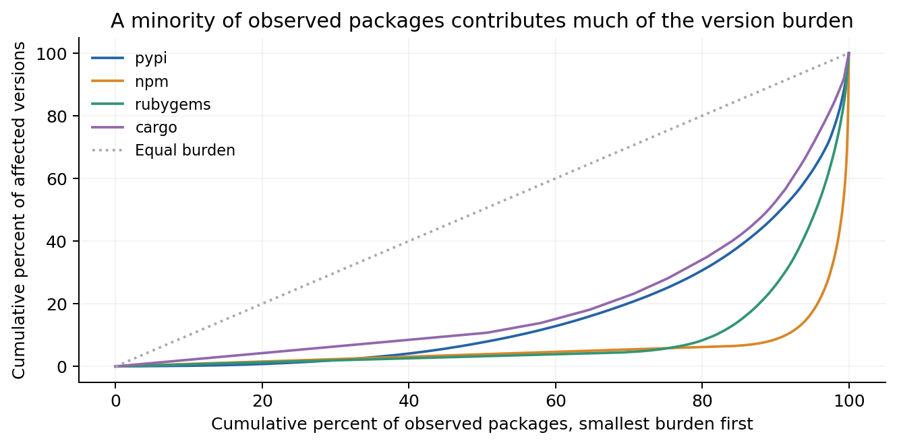
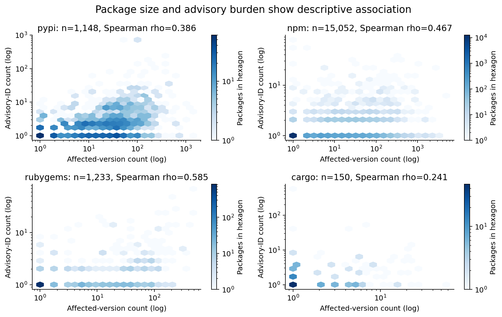

#  Phase 2 Report

Vulnerabilities affecting dependencies in software package managers

EAS 587 Phase 2

Manik Kashikar, Praveen Kumar, Sankeerth Reddy

# Executive Summary 
(we have to re write it ourselves)
The DiB-25 CSV supports a reproducible comparison of observed vulnerable associations across npm, PyPI, RubyGems and Cargo. Disk-backed processing reconciles 911,279 source records into 884,137 processed records after removing 27,142 exact normalized duplicates, all in RubyGems. The processed population contains 17,583 ecosystem-qualified packages, 279,284 package versions and 24,586 raw advisory IDs. Counting unit materially changes conclusions: npm supplies most observed packages, while PyPI supplies most associations; npm's high/critical severity share is 44.24% by association but 13.65% by ecosystem-advisory maximum. Its top 151 packages account for 52.41% of observed affected versions, identifying a concentrated descriptive burden. These findings support focused metadata investigation and Phase 3 feature design. They cannot establish all-package vulnerability prevalence, release-age patterns or resolved transitive exposure because the flat export lacks the required denominators, timestamps and dependency relationships.

# Connection to Phase 1

The initial research plan was on the efficient analysis of vulnerable package versions in four ecosystems for the purpose of supply chain researchers, security professionals, and package maintainers. The supporting questions of the research plan revolve around impact and version distributions, new versus old releases, similar data quality, and direct versus indirect exposures. Phase 2 is going to answer the distribution question from the data collected and profile its structural quality; however, other supporting questions require more data to be collected.

The source is DiB-25 from Zenodo record 15432733, version 3, DOI 10.5281/zenodo.15432733. The published database corpus represents about 4.4 million packages and 60,950,846 versions, which is not the population that is analyzed in this CSV dataset. The CSV file contains 820,011,561 bytes with 6 columns and 911,279 rows. All primary results are based on the entire cleaned dataset; an additional sample of 250,000 rows is used as a stratified sample to substitute the inconsistent sampling goals in the historical plan.

# Data Cleaning and Preprocessing

All six source columns are read as VARCHAR in order to keep package scope information, package identifier case, and version information. Exact cardinalities, blank and null counts, and duplicates are calculated by disk-based SQL computation over the entire source dataset; estimation of these statistics over a prefix of the source is not performed. Source SHA256 is fd3aa9b14c366b9a3759a0e3c99741e0f665f10cc01abee25920a9ae5ed24445.

| Source field | Assigned type | Distinct nonnull | Null | Blank |
| --- | --- | --- | --- | --- |
| package_name | VARCHAR | 17,153 | 0 | 0 |
| package_manager | VARCHAR | 4 | 0 | 0 |
| version_name | VARCHAR | 86,436 | 0 | 0 |
| vuln_id | VARCHAR | 24,586 | 0 | 0 |
| vuln_impact | VARCHAR | 78 | 0 | 0 |
| vuln_description | VARCHAR | 21,706 | 0 | 0 |

There are no blank fields of any type (descriptions included), there are no errors in the severity parse and no invalid IDs. Thus, completeness cannot be used as an argument for imputation and evidence that the missing data is random. Zero values have an unclear meaning in exporters, yet they are not equivalent to the absence or invalidity of severity. Distribution of data before processing can be seen in Figures 1-4 and 9.

The association key is the set (ecosystem, package, version, advisory). There may be several versions that refer to the same advisory. Global deduplication keeps the same normalized full payload, keeps the source_multiplicity and, most importantly, keeps and marks the conflict, rather than arbitrarily choosing which metadata to keep. In this run, there were no conflicting sets of keys. The only duplicates that were removed (27,142 in total, all in RubyGems and reducing it from 84,452 raw records to 57,310) affect ecosystem distribution.

| Accounting category | Records |
| --- | --- |
| Raw source | 911,279 |
| Exact normalized duplicates removed | 27,142 |
| Processed payload records | 884,137 |
| Invalid identifiers quarantined | 0 |
| Conflicting association key groups | 0 |

Text standardization includes removal of extra outer whitespace, normalization of the ecosystem labels and description lines, and preservation of the identifiers’ case and scoped name integrity. Derived columns contain the raw impact string, the parsed severity_score, the score_status and the severity_band. Compound hashes are used to generate entity keys. The severity bands are zero, low (0,4], medium [4,7), high [7,9), critical [9,10] and unknown. First_source_row and representative_raw_record_hash are used to preserve provenance. Payload_conflict detects metadata mismatches by an association key. Valid extremes are preserved, with log-transformed axes and median/IQR used for the skewed counts distributions. The 1.5 IQR rule is used to detect possible outliers for further consideration and not for removal; in npm’s zero IQR distribution this marks as a possible outlier any count that exceeds one.

# Processing and artifacts to save

The entry point is the following command: python -m src.pipeline --config config/phase2.yaml. This pipeline validates and verifies source with checksum, ingests CSV files, profiles inputs, cleanses, reconciles global duplicates, saves typed Parquet files, creates sample file, creates EDA and analytics tables and figures. Production code is in the src/ directory. The notebook uses and validates processed artifacts instead of hiding the cleaning steps in the cells. The configuration controls input path, processed data path, sample file path, results path, figures output path and database path.

DuckDB has been used for processing the dataset. The memory has been set at 768 MB, the number of threads is two, and a dedicated temporary folder has been created to save temporary data when the memory reaches its limit. While it would also be possible to use pandas for processing, loading the entire dataset as well as eliminating duplicates, especially those with extensive descriptions, might require even more memory. For that reason, the choice has been made to use DuckDB that offers processing large datasets through SQL without having to load everything into memory. The CSV file size is about 820 MB, while we did not need to process another dataset with 61 million versions of the graphs.

For the primary analysis, all 884,137 records that have been processed were used. Another sample consisting of 250,000 records has also been created using SHA-256, where the seed equals 5,872,026 to guarantee consistency of this sample regardless of how many times we would generate it again. In the created sample, all 2,735 records from Cargo, as well as 57,310 records from RubyGems were included owing to the smaller size. We selected 94,978 records from npm and 94,977 records from PyPI. We tried to achieve better ecosystem representation in this sample, for which reason the percentages are not consistent with those of the original data. For accurate estimate purposes when necessary, both inclusion_probability and sampling_weight have been preserved.

After cleaning and processing, the data have been saved in the form of data/processed/associations.parquet for further analysis. A quarantine.parquet file consisting of zero records has also been saved since no records should be separated in our case, and there is also a schema.json file that shows the list of column names and types. The data processed can now be reloaded without having to load the entire file into memory through src.data_access.load_processed function. Verification has revealed that the original counts of records match the processed ones.

In order to provide access to the dataset, we provided the entire processed Parquet file in divided ordered chunks, along with the true 250,000 sample and schema files. Using the tools/data_artifacts.py script, we validated the files using the SHA256 hash, which allows us to ensure that the files have not been modified. Also, the restore command can help combine all the divided files into the original Parquet file without downloading anything from other websites. If there is a need to reprocess the data from scratch, the original CSV file with the corresponding checksum can be used.

# Exploratory Data Analysis

For EDA, we utilized the entire processed dataset and performed 13 analyses. These analyses include ecosystem distribution, data quality, sampling, severity score, missing values, weight, vulnerability count, and correlation/concentration. We utilized graphs to gain an understanding of the distribution, and then provided a brief explanation using summary statistics. Time analysis is not possible for our dataset since it only includes six columns, without any date or time columns. Figures 1-5 and 9 display distribution, category, and missing values, while Figure 8 displays the relationship between two variables.

Figure 1. This is a graph showing the count of vulnerability associations, unique packages, package versions, and advisories for each ecosystem. Each individual graph displays its own count. We only utilized the records from our vulnerability dataset and not all available packages or versions.

The number of vulnerabilities associated with PyPI is 448,966 out of 884,137 (50.78%), whereas for npm, there are 15,052 out of 17,583 unique packages (85.61%). This proves that calculating vulnerabilities and unique packages gives us two different results because the same package can have multiple vulnerable versions and advisories. This will help to solve our Phase 1 distribution problem. But remember that the above numbers are from our vulnerability database only.

Figure 2. The chart depicts the percent of the processed records that contain missing or invalid severity scores, zero severity scores and blank descriptions in each ecosystem. It is reasonable to maintain zero severity scores apart as their true definition is not specified in the initial dataset. The percentages allow us to estimate the completeness of the dataset.

As a result of our analysis, we can state that there are no missing or invalid severity scores and blank descriptions in the processed records. However, the amount of zero severity scores varies for each ecosystem: RubyGems – 30.84%, PyPI – 30.33%, Cargo – 23.62% and npm – 17.15%. It becomes clear that despite the absence of the missing values in the discussed fields, it is important to clarify the meaning of the zero scores. We maintain zeros as is since their meaning is undocumented.

## Severity composition and counting units

Figure 3. In this figure, the share of vulnerability severity score is shown for each ecosystem. The scores were divided into five categories: zero, less than 4, from 4 to less than 7, from 7 to less than 9, and from 9 to 10. The category "unknown" includes missing or invalid scores. The score only reflects severity but does not indicate how easy it would be to exploit the vulnerability or how dangerous the package is.

Our analysis showed that npm contains 165,965 (44.24% of 375,126) of vulnerability associations with the severity score equal or higher than 7 compared to PyPI where this number equals 146,459 (32.62% of 448,966). In the current data set there are no missing or invalid scores and this makes possible the same share calculation for all processed entries. However, one vulnerability could affect different versions and the scoring approaches might vary, thus, we cannot make the statement that npm is riskier than PyPI.

Figure 4. The following graph depicts the cumulative distribution of the severity score for vulnerability associations and ecosystem-advisory IDs. The maximum value was considered for each advisory ID. Missing or invalid values were not included into calculations. Both curves depict different approaches to calculating severity score. It is possible that advisory ID could point to one vulnerability, while different recorded scores influence the maximum value.

Based on the obtained results, npm has 44.24% high or critical severity score among 375,126 associations, but it lowers to 13.65% among 16,847 ecosystem-advisory IDs. As for PyPI, the result transforms from 32.62% to 30.24%. It can be seen that one vulnerability impacting several versions of packages influences the results. Therefore, it is crucial to define what kind of values should be counted. Each ecosystem-advisory combination has one numeric severity score, however, some advisory IDs could describe one vulnerability.

ECDF was chosen because of fixed values of severity scores and some vulnerabilities' presence in many affected versions. The association-based and advisory-based results were kept separately due to their representation of different concepts. Regression, average trends or seasonal models were not used, therefore, checking model residuals is unnecessary.

## Resistant burden summaries and numeric score shape

Figure 5. Here is the graph which displays the number of affected versions per each package in each ecosystem. The boxes indicate Q1, median, and Q3; the lines represent 1.5 IQR range, while dots show the values which lie out of 1.5 IQR range. We have used the log scale in order to depict the packages which have very high values. Our data set consists only of vulnerable records without the release dates.

According to our findings, there are 1,148 packages in PyPI with the median equal to 24 and IQR equal to 50, while npm has 15,052 packages with the median of 1 and IQR of 0. There is one npm package which has 4,909 affected versions, so we can conclude that there is a big difference between packages. As we can see, the IQR of npm is 0, and thus, values greater than 1 are shown as the outliers according to the boxplot rule, but it does not necessarily mean that they are wrong. We have left these values as they are correct observations.

Figure 9. This chart provides an illustration of the distribution of severity scores in our processed data set. Zero scores are counted separately, but positive scores are counted within bins of 0.5 from 0 to 10. Missing and invalid scores are represented separately. A zero score does not indicate that the package is free of any danger.

From the data analysis, it can be stated that there are 218,849 zeros out of 884,137 associations (24.75%) that have a registered zero severity score and no missing or invalid scores. As for positive scores, 7.5 occurs 94,685 times and 9.8 occurs 66,977 times. Thus, there are instances of severity scores that are occurring more often than in accordance with a normal bell-curve. Intervals of 0.5 were used in order to evaluate the general trend of the distribution, while precise numbers are used in order to demonstrate frequent values.

# First Analytics Results

## Advisory reach and the distribution question

In this case, we have considered unique (package, version) pairs for each ecosystem-advisory ID, which could help us to answer the question about affected-version distribution posed by Phase 1, but does not mean that an advisory ID equals one separate security event. Table provides median and quartiles of observed advisory IDs.

Figure 6. This figure shows the number of distinct packages' ecosystem-qualified package versions associated with each ecosystem-advisory ID. The boxes represent Q1, median and Q3, whiskers are 1.5 IQR and dots represent outlying points. This figure represents observed reach of the advisories, but not separate security incidents.

The median reach of affected-package-version for 6,815 PyPI ecosystem-advisory IDs is 36, for RubyGems – 2, for npm and Cargo – 1. However, the maximal reach is 4909 for npm and 1420 for PyPI. Thus, even if the median reach is low, some advisories still reach a large number of versions. This partially answers our question from Phase 1, but these figures represent associations, not installations, exploitation or fully developed security events.

| Ecosystem | Advisory IDs | Median versions | Q1 | Q3 | Maximum |
| --- | --- | --- | --- | --- | --- |
| pypi | 6,815 | 36 | 11 | 81 | 1420 |
| npm | 16,847 | 1 | 1 | 1 | 4909 |
| rubygems | 1,961 | 2 | 1 | 31 | 444 |
| cargo | 1,017 | 1 | 1 | 2 | 57 |

There are 26,640 pairs of ecosystem-advisories while there are 24,586 unique advisories since 1,638 advisories are repeated more than once in at least one other ecosystem. The advisories were retained as repeated entities since it is impossible to make assumptions on their identicalness in the sense of vulnerability and causation of problems in other ecosystems. It was noted that there is no variation of the numerical severity scores for the same ecosystem-advisory pairs. Thus, the maximum score may be applied consistently.

## Concentration of observed affected versions

For each ecosystem, rank packages based on the number of observed affected versions. The top set consists of ceil(1% of observed packages), where the cardinality is reported, not implied, so that we have the explicit report of a top 1% group even when the population is small. If a package version is connected to several advisories, it will be counted only once towards the burden of that package. Thus, it provides the solution for the descriptive prioritization use case.

Figure 7. Lorenz curves for observed affected-version counts of ecosystem-qualified packages sorted by burden. Axes represent shares of packages and observed affected versions within the ecosystem. If a package version has several advisories, it is counted once toward the burden of the package.

The top 151 out of 15,052 npm packages include 52.41% of its 195,515 observed affected versions; the corresponding PyPI set of 12 packages includes 15.87% of observed affected versions. This shows the feasibility of describing the burden via the set of high-burden observed packages, which is ceil(1% of observed packages).

| Ecosystem | Observed packages | Top group | Top-group version share |
| --- | --- | --- | --- |
| pypi | 1,148 | 12 | 15.87% |
| npm | 15,052 | 151 | 52.41% |
| rubygems | 1,233 | 13 | 21.26% |
| cargo | 150 | 2 | 12.02% |

Packages belonging to the top 10% have an influence on 91.36% of affected versions in npm, 51.82% in PyPI, 74.27% in RubyGems and 47.38% in Cargo. It means that the number of affected versions is more concentrated in some ecosystems than others. We can reveal these differences from Lorenz curves, but we cannot observe such differences if we use average values only. We can use this data for further studies, but we cannot claim that packages having more affected versions are more exploited.

## Package count relationships and unanswered questions

In the current study, we considered the packages independently within their respective ecosystems. For that purpose, we employed Spearman correlation to find whether there is any correlation between the number of distinct affected versions and unique advisory IDs per package. We also constructed hexbin plots with logarithmic scaling to visualize the dependencies between those two factors. In that way, we prevent ourselves from displaying too many overlapped points.

Figure 8. This plot depicts the correlation between the number of affected version types and unique advisory IDs for each package. For each plot, we created hexbin charts on logarithmic scales; the colors depict the number of packages in each bin. Spearman correlation provides a method to understand the relation between two counts. We have not performed any regression analysis or analyzed causal relations and/or trend lines.

From our findings, we see that the Spearman correlations are PyPI 0.386 (1,148 packages), npm 0.467 (15,052), RubyGems 0.585 (1,233) and Cargo 0.241 (150). The values of all the correlations are positive, meaning that the packages with higher numbers of affected versions have higher numbers of advisory IDs. However, we can observe that there are quite a lot of packages with low numbers, some with the same numbers, and a few with very high numbers of them. Therefore, using only one straight line would not be able to represent this relation appropriately. Hexbin plots provide us with a way to represent this relationship without overlapping.

| Ecosystem | Observed packages | Spearman rho |
| --- | --- | --- |
| pypi | 1,148 | 0.386 |
| npm | 15,052 | 0.467 |
| rubygems | 1,233 | 0.585 |
| cargo | 150 | 0.241 |

These findings provide some answers to our question regarding the distribution of vulnerabilities and give insight into the quality of our CSV data. For the release age variable, we require release dates and correct ordering of versions as version numbers do not allow us to know the age of the release. For the direct and transitive dependencies variable, we require dependency relations, version requirements, and a metric for measuring the exposure. We haven’t yet recovered and validated the graph dump files. In phase 3, we require validation of the graph data and removal of duplicates for the advisory ID prior to using Spark, Lakehouse or prediction models. Additionally, our data includes only vulnerable records.

# Dead Ends

At the start, we used the first 250,000 records, but each one was from npm, which constitutes only 41.16% of the original data set. The gap is 58.84 percentage points. We realized that the CSV records were arranged according to the ecosystems, hence picking the first records did not result in a good sampling. For this reason, we dismissed that technique and used the entire data set with deterministic stratified sampling.

We also ruled out the idea of removing duplicates on the basis of advisory IDs only. The initial dataset comprises 911,279 data entries having 24,586 distinct advisory IDs, of which 10,860 have multiple affected versions. If we remove duplicates based on only advisory IDs, we may end up losing useful data about affected versions. Therefore, we opted for checking the complete record for duplicates while calculating the package, version, and advisory numbers separately.

# Design Decisions

Instead of working with the entire dataset in memory, we have chosen to use DuckDB with disk storage due to limited RAM. In terms of our main analysis, we have worked with the whole processed dataset rather than the balanced weighted sample that is mainly for exploration purposes. Rather than eliminating duplicate records based on advisory IDs only, we used combinations of identifiers as well as the complete records check. Zero and unknown severity were kept separate because we can’t assume that zero is safe or missing. Logarithmic scale, hexbin plot, and median and IQR rather than removal of outliers or linear fit because there are cases of valid high values and repetition of values.

# Reproducibility Statement

The full final project folder and the 13-cell notebook were tested on October 21 on a new Python environment without any system packages. All required dependencies were installed and the pipeline was run. All 13 automated tests were successfully performed and the following aspects were tested: different drives, external output folders and files, record counts, data cleaning, SHA256 hash of the source and sample records, calculated decimal values (matched with ours within a tolerance of 1e-12). We executed the notebook in a new kernel, examined the generated files and created all nine figures without any errors. The information about the test commands, environment, and file hashes was stored in results/completion_verification.json. Nonetheless, we tested all of the items on the same Windows machine instead of another teammate's PC or Colab. Such tests only prove that the code is functioning properly and cannot be used to verify completion of the assignment or preparation for the presentation.

# References

1. EAS 587 Project Phase 2 assignment, Fall 2026, supplied phase2_fall.docx.

2. EAS 587 Phase 2 Team Presentation Guidelines, Fall 2026, supplied seven-page PDF.

3. Team Phase 1 research_plan.md, September 17, 2026, preserved unchanged.

4. Zenodo. Data in Brief Material for Experimental Reproducibility, record 15432733, version 3. DOI 10.5281/zenodo.15432733. https://zenodo.org/records/15432733

5. Tukey, J. W. Exploratory Data Analysis. Addison-Wesley, 1977. Principles applied as summarized in the supplied course assignment.

